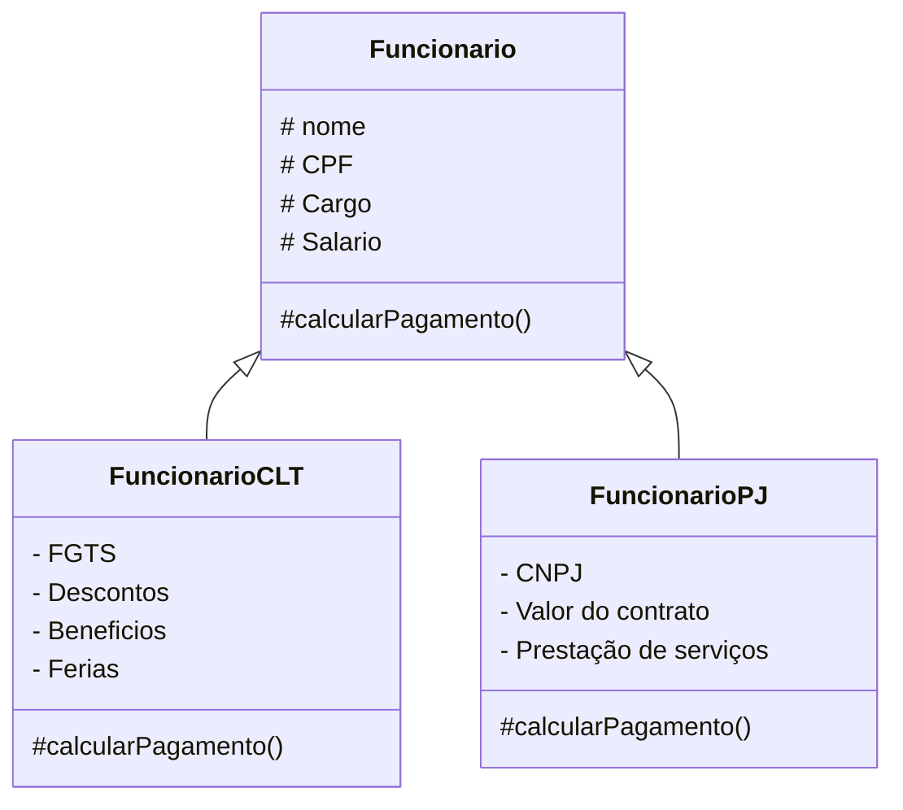

#  EXERCÍCIOS DE APROPRIAÇÃO

* O que é herança?

Herança é quando  uma classe aproveite atributos e métodos de outra classe.

* Qual a diferença entre private e protected?

O private, ou seja, o privado somente a própria classe pode acessar. Já o protected, ou seja, o protegido pode ser acessado pela própria classe e os filhos/netos.

* O que significa sobrescrever um método?

Sobrescrever é pegar um método herdado da classe pai e redefinir seu comportamento na classe filha.

# DESAFIO PROFISSIONAL

### A empresa quer adicionar Cliente Internacional no futuro.

* O código atual suporta essa mudança?

Sim. A estrutura pode suportar a criação de um ClienteInternacional, desde que exista uma classe base Cliente que possa ser herdada.

* O que precisa ser feito?

Seria necessário criar uma nova classe chamada ClienteInternacional, que herda de Cliente. Depois, podemos adicionar nela características específicas do cliente internacional.

* Onde entra o polimorfismo?

O polimorfismo entra quando Cliente e ClienteInternacional possuem um mesmo método, mas cada classe pode executá-lo de uma maneira diferente.

